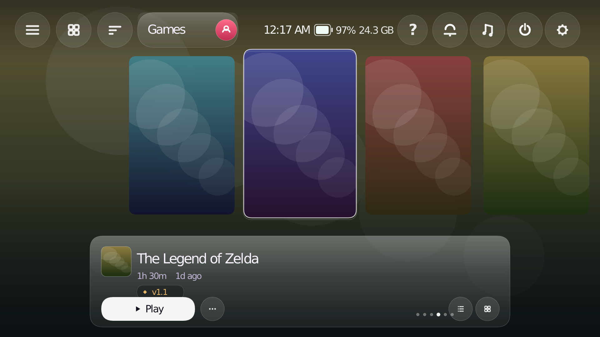
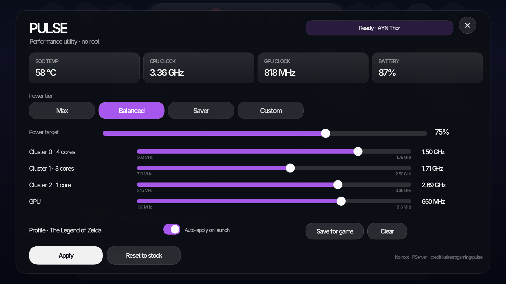
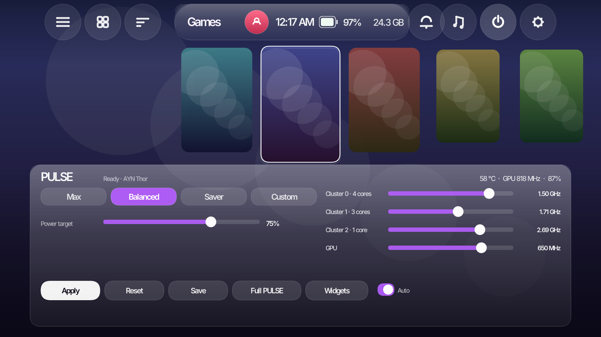

# NXS Launcher 1.1.0

A CardsNX-style Android launcher, rewritten in Rust. The whole launcher is one
`tiny-skia` scene rasterised into a pixmap and uploaded as one GL texture per
frame.



## What ships

- **Exact CardsNX layout** — coverflow card row with a focused card rim, glass
  info panel (icon, title, meta, version chip, Play pill, overflow, layout
  circles, page dots) and the circular top bar.
- **Per-game launch screen** — Settings → Launch screen chooses Auto, Top screen
  or Bottom screen for the selected game. The choice is stored per package and
  used the next time it launches. A switch flips which physical panel the
  launcher calls "top" for devices whose bottom panel is exposed as display 1.
- **PULSE underclocker** — the no-root PServer tuner, controlled from a compact
  panel in the bottom screen area or the full-screen panel. See below.
- **Dual screen** — Settings → Dual screen moves the game preview to the bottom
  screen area with three widgets (play activity, storage and online) above it.
  With PULSE open the compact tuner replaces those widgets until you switch
  back.
- **Custom media** — pick a box art icon or a hero background per game from the
  Settings sheet (system photo picker, no storage permission). Media is stored
  per package and reloaded on the next launch.
- **Render on demand** — the render thread sleeps on a condvar and only redraws
  when something actually changed, waking on a 30 s timer for the clock. An idle
  launcher draws nothing, which is what keeps it cool on a handheld.

## PULSE



PULSE talks to the stock `PServerBinder` service through a hidden-API reflection
call, so it needs no root and no daemon. The execution technique (write
`scaling_max_freq` per CPU policy, select an Adreno `max_pwrlevel`) follows
[keiretrogaming/pulse](https://github.com/keiretrogaming/pulse) and ClusterTune.

- **Power tiers** — Max (100%), Balanced (75%), Saver (55%) and Custom, with a
  20–100% power target that snaps to real CPU/GPU operating points.
- **Per-cluster CPU caps** — one slider per policy; a vendor-pinned prime floor
  is widened to the hardware minimum before the ceiling is written, because the
  kernel rejects a maximum below the minimum.
- **GPU cap** — the Adreno power-level table is mapped fastest-first and
  `min_pwrlevel` is widened first so the ceiling always sticks.
- **Per-game profiles** — save, clear and auto-apply a profile before a game is
  launched. Profiles store the tier, target, caps and GPU clock and are
  re-snapped if the device's OPP table differs.
- **Live telemetry** — SOC/battery temperature, CPU/GPU clocks and battery level,
  polled once a second while a panel is visible.
- **Apply / Reset** — Apply writes the profile through PServer; Reset hands the
  ceilings back at full range with mode 644 so the vendor performance service
  takes over again.
- **Compact bottom panel** — in dual-screen mode the bottom screen area shows
  tiers, target, every cluster, GPU, Apply/Reset, Save, Full PULSE and Widgets,
  plus the auto-apply switch.



The integration covers PULSE's no-root performance core. AutoTDP (which needs
frame-pacing telemetry), fan curves, RGB and the in-game OSD from the original
app are not part of this build.

PULSE needs a firmware that exposes `PServerBinder` — stock AYN and Retroid
handhelds do. On other devices the panel explains why it is unavailable and
disables Apply/Reset; the launcher itself is unaffected.

This build is signed with a new release key. Android will refuse to install it
over a 1.0.x build, so uninstall the old version first (settings and profiles
live in the app's private data and are reset by the uninstall).

## Size and speed

| | v1.0.1 (Kotlin) | v1.0.2 (Rust) |
| --- | --- | --- |
| Native core | — | 954 KB arm64 / 685 KB armv7 |
| APK (both ABIs) | — | 1.7 MB |
| Frames while idle | continuous invalidate | zero |

The Kotlin shell owns the `SurfaceView`, forwards surface/input/lifecycle events
to JNI and answers the platform callbacks (launch a package on a display, open
home settings, open the photo picker, probe/apply PULSE). Everything else —
layout, text shaping, blending, input hit testing, state — is Rust.

## Layout

```
rust/src/
  theme.rs    palette and the 1920x1080 design grid
  text.rs     ab_glyph outlines -> tiny-skia paths, measuring, ellipsis
  scene.rs    command list and painter (rounded rects, images, gradients)
  ui.rs       glass surfaces, glyphs, pills, dots
  model.rs    apps, pages, sort, overlays, touches, per-game screen slot
  home.rs     hero wash, top bar, coverflow, info panel
  dual.rs     activity / storage / online widgets + compact PULSE panel
  pulse.rs    PULSE state, profiles, telemetry, layout and drawing
  android.rs  EGL surface, JNI app enumeration, icons, preferences, JNI PULSE
  lib.rs      scene assembly, settings sheet and chrome caching
app/src/main/java/com/nxslauncher/
  NxsActivity.kt       surface, input, launch-on-display, photo picker, updater
  Pulse.kt             PServer discovery, sysfs probing, apply entry point
  PulseCommandBuilder.kt pure shell-script builder (unit tested)
```

## Building

```sh
export ANDROID_SDK_ROOT=$HOME/Android/Sdk   # must contain an NDK
./build-rust.sh                              # cargo build for the Android ABIs
gradle :app:testDebugUnitTest :app:assembleRelease
```

`build-rust.sh` cross-compiles `libnxs.so` for `arm64-v8a`, `armeabi-v7a` and
`x86_64` into `app/src/main/jniLibs`; Gradle packages them uncompressed so the
loader maps them straight out of the APK. Set `ARMV7=0` or `X86_64=0` to skip an
ABI.

Requires Rust stable with the Android targets, an NDK (r26+) and JDK 17.

Release signing is read from `keystore.properties` (gitignored):

```properties
storeFile=signing/nxs-release.jks
storePassword=…
keyAlias=nxs
keyPassword=…
```

Without that file Gradle falls back to the debug key.

## Host preview

The renderer is platform independent, so the exact same scene can be written to
a PNG instead of a window:

```sh
cd rust
export NXS_FONT_DIR=$PWD/../app/src/main/assets/fonts
cargo run --features preview --bin nxs-preview -- docs/home.png
cargo run --features preview --bin nxs-preview -- --dual docs/dual.png
cargo run --features preview --bin nxs-preview -- --settings docs/settings.png
cargo run --features preview --bin nxs-preview -- --pulse docs/pulse.png
cargo run --features preview --bin nxs-preview -- --pulse-bottom docs/pulse-bottom.png
```
